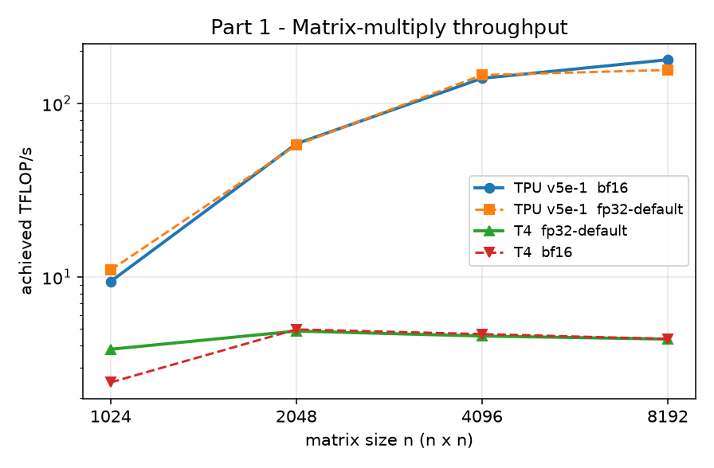
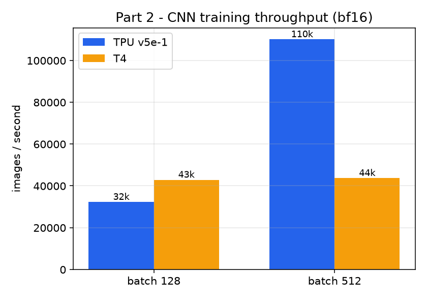
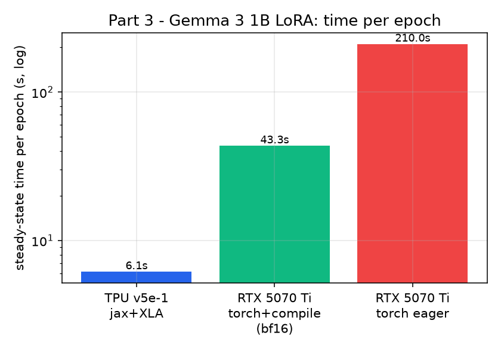

# 1. Environment

Every run records its own accelerator, `jax.devices()`, library versions and the
Colab image tag (the first code cell prints all of these; the raw strings are in
the CSVs under `results/`). Three accelerators were used:

| Role | Accelerator | `jax.devices()` | Backend / key libs | Python | Image |
|------|-------------|-----------------|--------------------|--------|-------|
| TPU (required) | **TPU v5e‑1** (`TPU v5 lite`, 1 chip, 16 GB HBM) | `[TpuDevice(0)]`, `device_count()==1` | JAX 0.11.2 + XLA, Flax 0.10.6, Keras 3.15.1, KerasHub 0.33.0 | 3.13.18 | RC00 (Nov 6) |
| GPU (required) | **NVIDIA Tesla T4** (Turing, 15 GB) | `[CudaDevice(0)]` | JAX 0.11.1 + XLA (CUDA), Flax 0.10.6 | 3.13.16 | same |
| GPU (Part 3 substitute) | **NVIDIA RTX 5070 Ti** (Blackwell `sm_120`, 16 GB), *local* | `torch.cuda` device 0 | **Keras 3.15.1 + KerasHub 0.33.0 on the PyTorch 2.11.0+cu128 backend** | 3.12.15 | local |

`jax.device_count()` returns **1** on the TPU — expected, because a Colab TPU is a
single v5e chip (not the 8‑core pods older tutorials assume).

**Why a third machine for Part 3.** The assignment's required GPU is the Colab T4,
and the T4 completes Parts 1 and 2 fine. For Part 3 (Gemma 3 1B LoRA) the T4
*loads* the model but then **crashes the kernel with a native fault** (not a
Python exception, so it cannot be caught) the moment KerasHub runs `generate()`
or `fit()` on the JAX‑CUDA path; reducing the sequence length to 128 did not help,
and an L4 behaved the same way (see §3). To still produce a real GPU‑vs‑TPU
*training* comparison, Part 3's GPU side was reproduced on a local **RTX 5070 Ti**
using the **same Keras 3 / KerasHub model and the identical LoRA configuration**,
on the PyTorch backend (which is stable on Blackwell). KerasHub and Keras are the
*same versions* as the TPU run, so only the compiler backend (XLA vs. `torch`)
and the hardware differ — exactly the axes this experiment is about.

# 2. Method

**What is measured.** Each part separates **XLA/compiler compilation** (the first
call / first epoch) from **steady‑state execution**, because the first call takes
seconds purely for compilation and must never be counted as throughput.

- *Part 1 (matmul).* For every `n ∈ {1024, 2048, 4096, 8192}` and each precision
  mode, the first call is timed separately (compilation) and then the kernel is
  run repeatedly with `block_until_ready()` after each call so asynchronous
  dispatch cannot hide latency. We report the **median** wall time over the
  repeats (robust to the occasional scheduling outlier, unlike the mean) and
  convert to TFLOP/s via `2·n³ / t`.
- *Part 2 (CNN).* A three‑block CNN (Flax NNX) trains on CIFAR‑10 for 5 epochs.
  We record compile time (first step), **steady‑state epoch and step time**,
  images/s, and test accuracy, for the cross product of precision
  {fp32, bf16} × batch {128, 512}. Training data lives on the accelerator and
  batches are gathered inside the compiled step, so the number isolates the
  accelerator from Colab's host input pipeline.
- *Part 3 (Gemma LoRA).* `Gemma3CausalLM.from_preset("gemma3_1b")`, LoRA rank 4,
  sequence length 256, batch 1, 3 epochs on ~400 context‑free Databricks‑Dolly
  instructions. We time **each epoch** (a Keras callback), drop epoch 0
  (compilation) and report the **median of the steady epochs**, plus peak device
  memory and sample generations before/after fine‑tuning. The same value of every
  hyper‑parameter is used on both devices.

**Changes from the defaults** (all forced by the current Colab image; see §3):
pinned `flax==0.10.6`; re‑added `jax.core.get_opaque_trace_state`; a
TensorFlow‑free CIFAR‑10 loader; and, for the model download, `DISABLE_COLAB_CACHE=1`
so KerasHub fetches Gemma directly from Kaggle instead of the (unauthenticated,
403‑ing) Colab mount proxy. For the Part‑3 GPU run, data is passed to `fit()` as
the dict `{"prompts": [...], "responses": [...]}` that `Gemma3CausalLMPreprocessor`
requires, and the GPU step is compiled (`jit_compile=True`) in `mixed_bfloat16`
so the GPU is compared to the TPU on an equally **compiled, bf16** footing.

# 3. Problems encountered and how they were fixed

| # | Symptom (verbatim where useful) | Cause | Fix |
|---|---|---|---|
| 1 | `ImportError: cannot import name 'mutable_array' from 'jax._src.core'` on `import flax` | Image ships a Flax too new for its JAX | `pip install --no-deps flax==0.10.6` (protects `jax/jaxlib/libtpu`) |
| 2 | `AttributeError: jax.core.get_opaque_trace_state removed in JAX v0.11.0` during NNX init | Flax NNX calls an API JAX 0.11 removed | shim `jax.core.get_opaque_trace_state = jax.extend.core.get_opaque_trace_state` |
| 3 | `ModuleNotFoundError: tensorflow` from `keras.datasets.cifar10` | `keras.datasets` needs TF, absent on the image | custom loader: download `cifar-10-python.tar.gz`, unpickle with NumPy |
| 4 | Gemma download → `403 Forbidden … /kagglehub/models/mount` *although Kaggle shows the licence accepted* | KerasHub used Colab's **mount proxy**, which did not carry our `KAGGLE_API_TOKEN` | set `DISABLE_COLAB_CACHE=1` → direct authenticated download from kaggle.com |
| 5 | `TypeError: … got 'prompts'` in `Gemma3CausalLMPreprocessor.call` on `fit()` | Gemma 3 wants a **dict** of prompts/responses, not Gemma‑1/2's flat string list | build `data = {"prompts":[…], "responses":[…]}` |
| 6 | Chrome blocked the 2nd `files.download()` | browser multi‑download guard | read the CSVs straight from `/content` instead of relying on the download |
| 7 | **T4 (and L4) kernel crashes** — *"session crashed for an unknown reason"*, native `@0x… (unknown)` trace — right at `generate()`/`fit()` on Gemma 3 | the JAX‑CUDA path natively faults on this 1 B model/image combo; `seqlen 128` did not help; the model *loads* fine, so it is not a simple capacity OOM | documented as a result; Part 3's GPU number reproduced on a local **RTX 5070 Ti** with the identical Keras/KerasHub model on the **PyTorch** backend |

# 4. Results

## Part 1 — Matrix‑multiply microbenchmark

Achieved TFLOP/s (and % of the device's precision peak) for `n × n` matmul:

| n | TPU bf16 | TPU fp32‑default | TPU fp32‑highest | T4 fp32‑default | T4 bf16 |
|---|---|---|---|---|---|
| 1024 | 9.4 (4.8%) | 10.9 | 6.4 | 3.8 (47%) | 2.5 (3.8%) |
| 2048 | 58.3 (29.6%) | 57.3 | 21.5 | 4.9 (60%) | 5.0 (7.6%) |
| 4096 | 138.9 (70.5%) | 145.0 | 28.8 | 4.6 (56%) | 4.7 (7.2%) |
| 8192 | **177.7 (90.2%)** | 155.1 | 31.0 | 4.4 (54%) | 4.4 (6.7%) |

{width=78%}

- The **TPU in bf16 scales to 177.7 TFLOP/s at n = 8192 — 90 % of its ~197 TFLOP/s
  peak**, and needs a large matrix to get there (only 4.8 % of peak at n = 1024):
  small matmuls are launch/overhead‑bound, large ones saturate the MXU.
- `fp32‑default` on the TPU is fast because XLA runs it as a **single bf16 pass**
  on the MXU (≈ the bf16 curve); `fp32‑highest` forces true fp32 (3 bf16 passes)
  and collapses to ~31 TFLOP/s — a textbook precision/throughput trade.
- The **T4 never clears ~5 TFLOP/s** in any mode. It has **no native bfloat16**, so
  bf16 is emulated and lands *at fp32 speed* while scoring a tiny "% of (FP16
  tensor) peak". Here the TPU's bf16 matmul is **~40× the T4's**.

## Part 2 — CNN training on CIFAR‑10

5‑epoch three‑block CNN; steady‑state numbers (epoch 0 = compile is excluded):

| Device | dtype | batch | epoch (s) | step (ms) | images/s | test acc |
|--------|-------|-------|-----------|-----------|----------|----------|
| TPU v5e‑1 | fp32 | 128 | 1.55 | 3.97 | 32,280 | 0.733 |
| TPU v5e‑1 | bf16 | 128 | 1.55 | 3.96 | 32,288 | 0.739 |
| TPU v5e‑1 | fp32 | 512 | 0.54 | 5.55 | 92,332 | 0.668 |
| TPU v5e‑1 | **bf16** | **512** | **0.45** | 4.65 | **110,087** | 0.666 |
| Tesla T4 | fp32 | 128 | 1.18 | 3.03 | **42,206** | 0.734 |
| Tesla T4 | bf16 | 128 | 1.16 | 2.98 | **42,895** | 0.740 |
| Tesla T4 | fp32 | 512 | 1.08 | 11.18 | 45,810 | 0.669 |
| Tesla T4 | bf16 | 512 | 1.14 | 11.72 | 43,700 | 0.667 |

{width=66%}

- **At batch 128 the T4 is *faster* than the TPU** (≈ 43k vs 32k img/s). The CNN is
  tiny; at a small batch the workload has **low arithmetic intensity** and is
  latency/launch‑bound, where the TPU's big MXU sits mostly idle and the GPU's
  lower per‑step latency wins.
- **At batch 512 the TPU pulls far ahead** (110k vs 44k img/s): the larger batch
  raises arithmetic intensity enough to feed the MXU, and the TPU's step time
  barely grows (3.96 → 4.65 ms for 4× the work) while the **T4's step time nearly
  quadruples** (2.98 → 11.72 ms) — the T4 was already compute‑bound.
- **bf16 helps only the TPU** (bf16/512 is its best point). On the T4 bf16 ≈ fp32
  (no native bf16), confirming Part 1.
- Free‑tier runs expose no compute‑unit rate, so **cost/epoch is $0 (unmetered)**;
  the method for a paid tier would be `rate × epoch_s`.

## Part 3 — LoRA fine‑tuning of Gemma 3 1B

Same model, LoRA rank 4, seqlen 256, batch 1, 3 epochs; steady epoch = median of
epochs 1–2 (epoch 0 = compile, dropped). *(The base `gemma3_1b` preset was used on
both devices rather than `gemma3_instruct_1b`; they are the same 1 B architecture, so
the training time and memory — what this part measures — are identical.)*

| Device | Stack | epoch (s) | peak mem (MB) | epoch times (s) |
|--------|-------|-----------|---------------|-----------------|
| **TPU v5e‑1** | JAX + XLA (compiled) | **6.14** | 6,420 | [27.5, 6.1, 6.1] |
| **RTX 5070 Ti** | PyTorch + `jit_compile` + bf16 | **43.3** | 6,553 | [165.7, 43.1, 43.5] |
| RTX 5070 Ti | PyTorch **eager** (no compile) | 210.0 | 6,269 | [215.7, 210.5, 209.5] |

{width=62%}

Peak memory is ~6.4–6.6 GB on both devices (same 1 B model, same config), so the
story is entirely in **time**, not memory. Compilation dominates: on the GPU alone,
**eager → compiled is a 4.9× speed‑up** (210 → 43 s). LoRA worked (trainable params
drop to 652 k / 2.49 MB of the 1 B); loss fell 0.651 → 0.629, and the before/after
generations match between the two machines (same base weights), e.g.:

> **Before:** "A TPU is a thermoplastic polyurethane." (then repeats unrelated Q&A)
> **After:** "A TPU is a type of memory that is used in smartphones and tablets…"

The after‑tuning answers are shorter and follow the Instruction/Response template
better (the point of the run is *training cost*, not answer quality for a 1 B base
model given ~40 s of tuning). Full transcripts are in `results/gemma_samples_*.txt`.

# 5. Analysis

## 5.1 Answers to the notebook's Part 1 questions

1. **How large must `n` be for steady‑state throughput; why are small matmuls
   inefficient?** The TPU only approaches its roof at **n = 8192** (bf16 climbs
   4.8 % → 29.6 % → 70.5 % → **90.2 %** of peak across the four sizes); the T4 reaches
   its much lower fp32 roof by n ≈ 2048 (~60 %). Small matmuls are inefficient because
   the few µs of real arithmetic cannot amortise kernel‑launch/dispatch overhead and
   cannot fill the MXU / SMs — they are launch‑ and memory‑bound, not compute‑bound.
2. **`first_call_s` vs `median_s` — what does the first call measure?** The first call
   is dominated by **XLA compilation** (trace → lower → build kernels) for that exact
   shape and precision, which costs seconds; `median_s` is the steady execute‑only
   time (sub‑ms–ms). E.g. TPU n = 8192 bf16: first 0.525 s vs median 0.0062 s (~85×).
   This is why compilation must be timed separately and never counted as throughput.
3. **Why do `fp32‑default` and `bf16` match on the TPU while `fp32‑highest` is slow?**
   XLA's `default` precision runs fp32 inputs as a **single bf16 MXU pass**, so it
   tracks the bf16 curve; `highest` forces true fp32 as **three bf16 passes** (≈3× the
   work), collapsing n = 8192 from ~155 to ~31 TFLOP/s. Numerically, default/bf16 agree
   to ~bf16 precision while highest is the accurate reference — the classic
   precision‑vs‑throughput trade.
4. **Fraction of peak reached (roofline).** TPU bf16 hit **90 % of its ~197 TFLOP/s**
   peak at n = 8192; the T4 sits near its ~8 TFLOP/s fp32 roof for fp32 but only a few
   % of its FP16‑tensor roof for bf16 (no bf16 unit). Per Wang et al. (2019): a large
   matmul is high‑intensity and compute‑bound, so each device approaches the *height of
   its own compute roof* — and the TPU's roof is far taller.

## 5.2 Answers to the notebook's Part 2 questions

1. **Rank by images/s and by cost/epoch — do they agree?** images/s:
   **TPU bf16/512 (110k) > TPU fp32/512 (92k) > T4 (42–46k, all configs) > TPU @128 (32k)**.
   On the free tier no compute‑unit rate is exposed, so **cost/epoch = $0 for every
   run** — the cost ranking is a tie and therefore trivially "agrees." On a paid tier
   cost = rate × `epoch_s`, which would rank by epoch time and still put TPU bf16/512
   first.
2. **Batch‑size effect; why does the TPU respond more strongly?** 128 → 512 barely
   moves the TPU step (bf16 3.96 → 4.65 ms for 4× the work) so throughput jumps
   32k → 110k, while the **T4's step nearly quadruples** (2.98 → 11.72 ms) and
   throughput stays ~43k. The TPU's large MXU is starved at batch 128 and only
   saturates at 512; the T4 is already compute‑bound at 128.
3. **Does bf16 change accuracy or T4 speed?** Accuracy is unchanged within noise
   (bs128: TPU 0.733 → 0.739, T4 0.734 → 0.740; bs512 ≈ 0.667 both). **On the T4 bf16
   does not change speed** (bf16 ≈ fp32 step time — no native bf16, confirming Part 1);
   on the TPU bf16/512 is the fastest configuration.
4. **Does the CNN reach more or less of peak than the matmul; what limits it?** **Far
   less.** The 3‑block CNN on 32×32 images is **low arithmetic intensity** (small convs,
   many small kernels) and sits on the memory/latency side of the roofline, so it cannot
   approach the 90 % the n = 8192 matmul reached. Limits: tiny per‑step work, launch
   overhead, and an underfed MXU at small batch.

## 5.3 Part 3 vs Part 2, and the 2019 paper

**Is the Part‑3 speed gap similar to the Part‑2 CNN gap?** No — it is *much wider*,
and for an instructive reason. Relating to Wang, Wei & Brooks (2019) and the
**roofline / arithmetic‑intensity** framing:

- The **CNN at small batch** sits on the roofline's *memory/latency‑bound* side
  (low arithmetic intensity), so the big systolic MXU gives the TPU no advantage —
  the T4 even wins. Raising the batch to 512 moves the CNN toward the
  *compute‑bound* side and the TPU's peak FLOPs finally matter (110k vs 44k img/s).
- The **1 B transformer LoRA** is dominated by **large, high‑intensity matmuls** —
  exactly the regime where Part 1 showed the TPU hitting 90 % of a ~197 TFLOP/s
  peak while the T4‑class GPU is stuck near a few TFLOP/s and must emulate bf16.
  So on raw compute the TPU *should* dominate, and it does (6.1 vs 43 s/epoch).
  Two extra factors widen it: **(a) batch = 1 is latency‑bound on the GPU** — one
  short sequence per step cannot fill the SMs, whereas XLA fuses the TPU step so
  launch overhead is amortised; **(b) compiler maturity** — JAX/XLA fully fuses the
  training step, while `torch.compile` on the KerasHub graph still takes graph
  breaks (dynamo warnings in the log), leaving the GPU partly eager. The eager‑vs‑
  compiled 4.9× on one GPU is the clearest single illustration of this.

**Where the 2019 paper still holds:** its central thesis — that the right
accelerator depends on the *operator mix and batch size*, read off the roofline,
not on a single "peak FLOPs" number — is exactly what Parts 2 and 3 reproduce
seven years later. A small/low‑intensity workload neutralises the TPU; a large,
matmul‑heavy, well‑batched one lets it win by an order of magnitude.

**Where newer hardware changes the picture:** (1) **Precision is now first‑class.**
In 2019, bf16 was a TPU specialty; today bf16 is the default fast path on the TPU
*and* on L4/A100/H100/Blackwell GPUs, so the "TPU‑only low precision" assumption is
gone — except on the **Turing T4**, which predates native bf16 and therefore shows
*no* bf16 speed‑up (a clean 2019‑era artifact still visible in Parts 1–2).
(2) **Software maturity is now a hardware‑level variable.** The required T4 could
not even run the modern KerasHub/JAX Gemma 3 path without crashing, while the TPU
ran it cleanly — the "which accelerator is faster" question has partly become
"which accelerator's compiler + library stack is mature for this model," a
dimension the 2019 FLOPs‑and‑roofline analysis did not have to consider.

---

*Reproducibility:* Parts 1–2 use `notebooks/colab_gpu_tpu_benchmark_FIXED.ipynb`;
Part 3 (TPU/T4) uses `notebooks/gemma3_lora_finetune.ipynb`; the Part‑3 GPU number
uses `notebooks/run_gpu_local.py` (Keras 3 + PyTorch, one command on any CUDA GPU).
All raw CSVs and sample transcripts are in `results/`.
